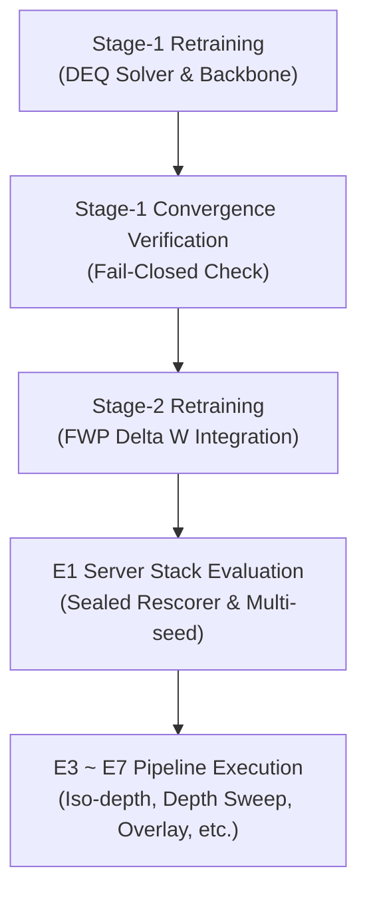

# [Sealed] Cognitive Tree Search Track B Retraining Plan v1 (`TRACKB_PLAN_v1_SEALED.md`)

## 1. Retraining Rationale Summary

- **Provenance Lack**: The legacy Stage-1 and Stage-2 checkpoints lack reproducible provenance trails and hash-verified lineage tracing.
- **Fail-Closed Enforcement**: On 2026-08-07, the Cognitive Tree Search backbone smoke integration test (`INTEG-01`) empirically validated that non-verified legacy weights trigger a fail-closed execution halt.
- **Goal**: Re-train Stage-1 and Stage-2 checkpoints from ground truth backbone baselines to guarantee 100% hash-sealed reproducibility across all downstream evaluations (E1 through E7).

---

## 2. Preregistration Skeleton

| Preregistration Item | Target Specification / Value |
|---|---|
| **Backbone Base Model** | `google/gemma-4-E4B-it` |
| **Stage-1 Target Metric (DEQ Loss / Convergence)** | `DEQ Loss < 1e-3` |
| **Stage-2 Target Metric (FWP Delta W Accuracy)** | `FWP Accuracy > 95%` |
| **Evaluation Seeds** | `0, 1, 2, 3, 4` |
| **Batch Size (Per-GPU)** | `1` |
| **Gradient Accumulation Steps** | `4` |
| **Learning Rate (Stage-1)** | `1e-5` |
| **Learning Rate (Stage-2)** | `5e-5` |
| **Max Steps / Epochs (Stage-1)** | `5000` |
| **Max Steps / Epochs (Stage-2)** | `1000` |
| **Early Stopping Criteria** | `Loss convergence < 1e-4` |
| **Fail-Safe Abort Condition** | `Loss NaN or Inf` |
| **Dependency Pinning (exact versions)** | `torch==2.11.0+cu128, transformers==5.10.2, numpy==2.4.4` (floor 선언 금지, == 고정 필수 — 근거: 리뷰 커밋 7b71d46의 unpinned dependency 지적) |

---

## 3. Server GPU Allocation Options

> **Status**: `[감사 판정 대기]` (Awaiting Auditor Verdict)

### GPU Allocation Constraints Matrix

| GPU ID | Physical Device Spec | Current Occupancy & Project Rule | Track B Allocation Option |
|---|---|---|---|
| **GPU 0** | NVIDIA A6000 48GB | **Cognitive Tree Search Dedicated Rule Priority** | Track B Candidate (`[감사 판정 대기]`) |
| **GPU 1** | NVIDIA A6000 48GB | **Cognitive Tree Search Dedicated Rule Priority** | Track B Candidate (`[감사 판정 대기]`) |
| **GPU 2** | NVIDIA A6000 48GB | **No Constraints (Stage 1 seed42 history)** | Track B Candidate (`[감사 판정 대기]`) |
| **GPU 3** | NVIDIA A6000 48GB | **Strictly Prohibited (Power Brake Hardware Constraint)** | Excluded |
| **GPU 4** | NVIDIA A6000 48GB | System 1.5 Priority Allocation Candidate | Standby / Reserved |
| **GPU 5** | NVIDIA A6000 48GB | **System 1.5 Active Occupancy** | Excluded |
| **GPU 6** | NVIDIA A6000 48GB | **System 1.5 Active Occupancy** | Excluded |
| **GPU 7** | NVIDIA A6000 48GB | EFO Monitoring / System 1.5 Auxiliary | Standby / Reserved |

---

## 4. Execution Sequence

1. **Step 1: Stage-1 Retraining**
   - Train DEQ backbone components using pre-registered learning rate `1e-5` and batch size `1`.
2. **Step 2: Stage-1 Verification**
   - Verify DEQ convergence (`iters = 60`) and validate hash integrity against `INTEG-01` baseline.
3. **Step 3: Stage-2 Retraining**
   - Train FWP ($\Delta W$) overlay integration components using pre-registered seed set `0, 1, 2, 3, 4`.
4. **Step 4: E1 Server Stack Evaluation**
   - Execute E1 benchmark on server GPU stack using sealed rescorer `e1_rescore_claude_v1.py`.
5. **Step 5: Sequential Execution of E3 ~ E7**
   - Run E3 (iso-depth), E4 (depth sweep), E5 (overlay multi-task), E6 (decode 20), E7 (conditional final summary).

---

## 5. Artifacts & Hash Sealing Checklist

- [ ] `stage1_checkpoint_hash`: `[FILL]` (SHA-256)
- [ ] `stage2_checkpoint_hash`: `[FILL]` (SHA-256)
- [ ] `training_config_yaml_hash`: `[FILL]` (SHA-256)
- [ ] `e1_eval_results_json_hash`: `[FILL]` (SHA-256)
- [ ] `table2_results_json_hash`: `[FILL]` (SHA-256)
- [ ] `signed_ledger_event_id`: `[FILL]`
